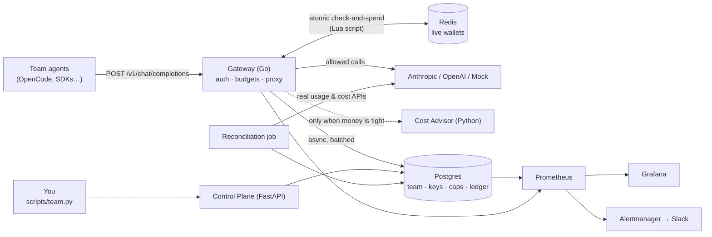

<p align="center">
  
</p>

<p align="center">
  <b>Give every teammate's AI agent its own spending cap, on one shared API key.</b><br>
  A drop-in gateway for OpenAI-compatible agents. Runaway loops get a <code>429</code>, not your credit card.
</p>

<p align="center">
  <a href="#try-it-in-2-minutes"></a>
  <a href="docs/team-setup.md"></a>
  <a href="LICENSE"></a>
</p>

<p align="center">
  
  
  
  
  
  
</p>

---

## The problem

Your team shares one Anthropic or OpenAI key. Several people run coding agents
on it all day. One agent gets stuck in a loop at 2am, and you find out when the
invoice arrives.

## The fix

Put **Budget Governor** in the middle. The real key lives only on your server.
Each teammate gets their **own key with their own daily cap**. Every AI call is
checked before it is sent:

| Feature | What it means |
|---|---|
| **Per-person keys** | Bob's key always spends Bob's budget. He can't use Sarah's, and he never sees the real key. |
| **Hard caps** | Over budget means a `429`. Only that person stops. Everyone else keeps working. |
| **Fair refill** | A $25/day cap refills evenly over 24h, so nobody is locked out until midnight. |
| **Soft landing** | Running low? The gateway can switch the call to a cheaper model before blocking it. |
| **Real agent support** | Tools, tool calls, images and streaming all work, for both GPT and Claude models. |
| **Slack alerts** | "kyle has used 80% of their daily cap", while it is happening, not after. |
| **Bill checking** | A job compares the gateway's records with the provider's real bill and flags gaps. |

<p align="center">
  
</p>

---

## How it works, in 30 seconds

```
  Bob's agent ──┐                                ┌──► Anthropic
  Sarah's     ──┼──►  GATEWAY  ① who is this?    ├──► OpenAI
  Kyle's      ──┘             ② can they afford it?
                              ③ forward, or block with 429
                              ④ record the real cost
```

1. **Who is this?** The gateway looks up the key. Each key belongs to one person.
2. **Can they afford it?** It estimates the cost and checks two wallets in
   Redis at once: the person's and the team's. Both must have room.
3. **Forward or block.** If yes, the call goes to Anthropic or OpenAI with the
   real key. If no, it can try a cheaper model, otherwise it returns `429`.
4. **Record.** The real cost comes back, the estimate is corrected, and one row
   lands in the Postgres ledger. Dashboards and alerts read from there.

Want the full picture? See [How it fits together](#how-it-fits-together) below.

---

## Try it in 2 minutes

No API keys needed. Models whose name starts with `mock-` are answered by a
built-in fake provider with realistic latency and real pricing math.

```bash
git clone https://github.com/Horunu/budget-governor.git
cd budget-governor
cp .env.example .env
```

```bash
make up      # start everything (Docker)
```

```bash
make demo    # watch one agent get allowed, throttled, rerouted, blocked
```

Then open:

| What | URL | Login |
|---|---|---|
| Grafana dashboards | http://localhost:3000 | `admin` / `admin` |
| Alerts | http://localhost:9093 | |
| Prometheus | http://localhost:9091 | |

Other commands: `make seed` (demo data), `make smoke` (end-to-end check),
`make bench` (load test), `make logs`, `make down`.

---

## Set it up for your team

**1. Put your real key on the server** and start it:

```bash
# in .env
ANTHROPIC_API_KEY=sk-ant-...
OPENAI_API_KEY=sk-...        # optional
```

```bash
make up
```

**2. Create the team and add people** with `scripts/team.py`:

```bash
python3 scripts/team.py init my-team --daily 100   # team-wide cap, prints your admin key
```

```bash
python3 scripts/team.py add bob --daily 25         # prints Bob's key + setup lines
```

**3. Run it day to day:**

| Command | What it does |
|---|---|
| `team.py list` | Everyone's cap and last-24h spend |
| `team.py cap bob --daily 40` | Change Bob's cap |
| `team.py cap --daily 150` | Change the team cap |
| `team.py rotate bob` | Bob lost his key: kill it, issue a new one |
| `team.py remove kyle` | Cut someone off (history is kept) |

**4. Optional: Slack alerts.** Save a Slack incoming-webhook URL to
`observability/alertmanager/slack_webhook` and run `make up` again.

Full guide: **[docs/team-setup.md](docs/team-setup.md)**

---

## Connect your agents

Each teammate points their agent at the gateway with their own key. That is
the only change they make.

```bash
export OPENAI_BASE_URL=https://your-gateway/v1
export OPENAI_API_KEY=<their bg_live_ key>
```

They can call Claude through it too: use `"model": "claude-sonnet-5"` and the
gateway translates to Anthropic and back.

<details>
<summary><b>OpenCode config</b></summary>

`~/.config/opencode/opencode.json`:

```json
{
  "$schema": "https://opencode.ai/config.json",
  "provider": {
    "budget-governor": {
      "npm": "@ai-sdk/openai-compatible",
      "name": "Budget Governor",
      "options": {
        "baseURL": "https://your-gateway/v1",
        "apiKey": "{env:BG_API_KEY}"
      },
      "models": {
        "claude-sonnet-5": { "name": "Claude Sonnet 5" },
        "gpt-4o-mini": { "name": "GPT-4o mini" }
      }
    }
  }
}
```

</details>

| Client | Works? |
|---|---|
| OpenCode, Vercel AI SDK, LangChain, aider, Continue, OpenAI SDKs | via `/v1/chat/completions` |
| Codex (Responses API, `/v1/responses`) | Not yet |
| Claude Code (Messages API, `/v1/messages`) | Not yet |

---

## What happens when someone runs low

```
 Bob can't afford this call
        │
        ▼
 Cost Advisor (an LLM, 300ms max): "try a smaller model?"
        │
        ▼
 Policy engine (plain rules, always has the final say)
        │
   ┌────┴─────────────────────┐
   ▼                          ▼
 cheaper option fits        nothing fits
 → run it, response says    → 429 over_agent_budget
   "budget_advisory: ..."     Bob's agent stops. Nobody else does.
```

The AI advisor only **suggests**. It can never approve spending.

---

## How it fits together



| Piece | Its one job | Code |
|---|---|---|
| **Gateway** | The checkpoint every AI call passes through | [`gateway/`](gateway/) |
| **Redis** | Live wallets: how much each person and the team have left | [`checkAndDecrement.lua`](gateway/internal/budget/checkAndDecrement.lua) |
| **Postgres** | The record: team, members, hashed keys, caps, one row per call | [`migrations/`](migrations/) |
| **Control plane** | Admin API behind `team.py` | [`controlplane/`](controlplane/) |
| **Cost advisor** | Suggests cheaper options under budget pressure | [`advisor/`](advisor/) |
| **Policy engine** | Fixed rules that decide what actually happens | [`gateway/internal/policy/`](gateway/internal/policy/) |
| **Reconciliation** | Checks the ledger against the provider's real bill | [`reconciliation/`](reconciliation/) |
| **Observability** | Dashboards, alert rules, Slack routing | [`observability/`](observability/) |

<details>
<summary><b>Why it's built this way</b></summary>

- **One atomic Redis step.** Ten agents hitting the same wallet at once can't
  spend the same last dollar twice, and many gateway replicas can share one
  budget.
- **Estimate, then settle.** The real cost is only known after the answer, so
  the gateway reserves the worst case and refunds the difference.
- **Fail closed.** A team with no budget configured cannot spend at all.
- **Nothing slow on the hot path.** Keys and caps are cached in memory; spend
  is written to Postgres in the background.
- **LLM advises, rules decide.** See ADR-003 in
  [`docs/DECISIONS.md`](docs/DECISIONS.md).

</details>

---

## Repo map

```
gateway/          Go request path: auth, budgets, provider adapters, streaming, policy
controlplane/     FastAPI admin API: teams, members, keys, caps, spend, incidents
advisor/          Python cost advisor (LLM suggestions)
reconciliation/   Scheduled job comparing spend with provider billing
providers/        Shared Python pricing table
migrations/       SQL schema
observability/    Prometheus rules, Alertmanager, Grafana dashboards
scripts/          team.py, seed, smoke, demo, benchmark, migrate
loadtest/         k6 load tests
deploy/           docker-compose
docs/             Team setup, architecture, decisions, runbook
```

## Docs

- **[Team setup](docs/team-setup.md)**: the 10-minute guide for a real team
- **[Architecture](docs/ARCHITECTURE.md)**: request sequence, failure modes, scaling
- **[Decisions](docs/DECISIONS.md)**: why each big choice was made
- **[Runbook](docs/RUNBOOK.md)**: what to do when each alert fires

## Before trusting it with real money

- **Check the prices.** The pricing tables in
  [`gateway/internal/provider/pricing.go`](gateway/internal/provider/pricing.go)
  and [`providers/pricing.py`](providers/pricing.py) are hand-maintained and
  dated. Compare them with the providers' current pricing pages.
- **Change `PLATFORM_BOOTSTRAP_TOKEN`** in `.env` before exposing the server.
- **Billing reconciliation** needs org admin keys (`OPENAI_ADMIN_KEY`,
  `ANTHROPIC_ADMIN_KEY`), which are separate from normal API keys.

## Tests

```bash
make test
```

Runs every service's suite. The Python services each need their own venv
first: `python3 -m venv .venv && pip install -e ".[dev]"` inside the service
folder.

## License

[MIT](LICENSE)
